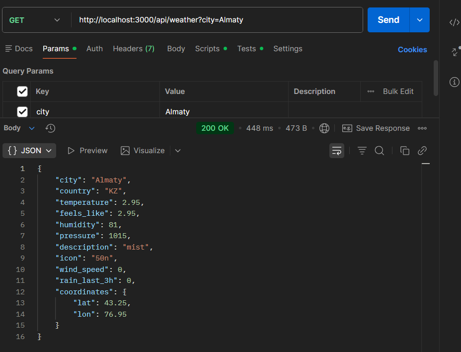
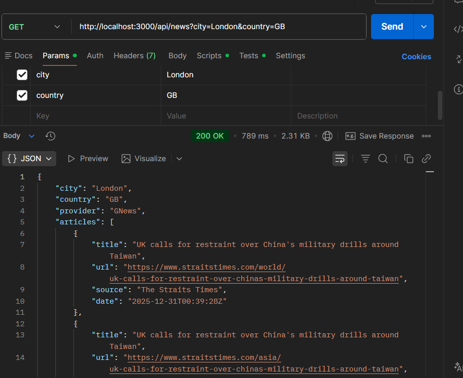
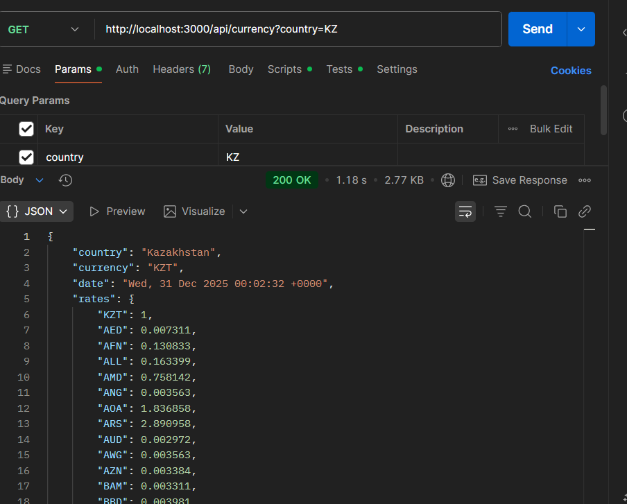
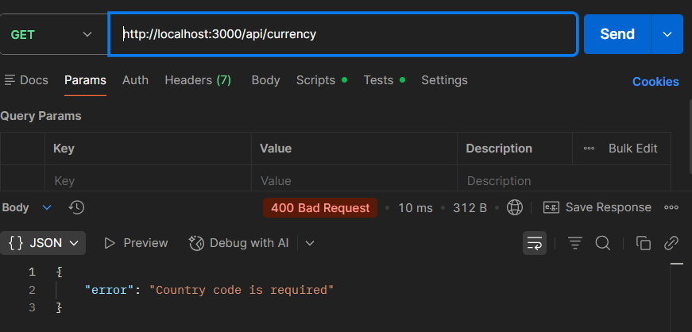

# Weather & City Information App

This project is a responsive web application that provides real-time **weather information**, **interactive maps**, **city-related news**, and **currency exchange rates** using multiple APIs.

The application demonstrates proper **API integration**, **server-side logic**, **clean project structure**, and **responsive UI design**, following best practices learned throughout the course.

---

## Project Objective

The objective of this assignment is to:
- Learn how to work with APIs
- Retrieve, process, and display external data
- Integrate multiple APIs
- Build a clean, responsive, and user-friendly web application

---

## Core Features

### Weather Information (OpenWeather API)
- City name and country code
- Temperature and “feels like” temperature
- Weather description and icon
- Humidity
- Pressure
- Wind speed
- Rain volume (last 3 hours)
- Geographic coordinates (latitude & longitude)

### Geolocation & Mapping
- Interactive map using **Leaflet**
- City location displayed based on coordinates
- Marker with city label

>  All application logic is implemented in **JavaScript**, not in HTML.

---

## Additional APIs Integration (Server-side Only)

###  1. News API (City-related news)
- **GNews API**
- **NewsAPI.org**
- Automatically fetches recent news articles related to the selected city or region
- Uses fallback logic to ensure results for international cities
- Runs entirely on the **server side**
- No API keys are exposed in frontend code

### 2. Currency Exchange Rates API

- **REST Countries API** → retrieves local currency code
- **open.er-api.com** → retrieves exchange rates
- Displays:
  - Local currency
  - USD, EUR, GBP, RUB, CNY, TRY
- Highlights local currency
- Fully server-side implementation

---

## Project Structure

weather_app/
├── public/
│ ├── index.html
│ ├── app.js
│ └── styles.css
│
├── routes/
│ ├── weather.js
│ ├── news.js
│ └── currency.js
│
├── server.js
├── package.json
├── .env
└── README.md

---

## ⚙️ Setup Instructions

### 1️⃣ Install dependencies

```bash
npm install
```

### 2️⃣ Create a `.env` file in the root directory

```env
OPENWEATHER_API_KEY=your_openweather_key
GNEWS_API_KEY=your_gnews_key
NEWSAPI_API_KEY=your_newsapi_key
PORT=3000
```

API keys are stored in `.env` and are never exposed to the frontend.

> Add `.env` to `.gitignore` to prevent API keys from being committed to GitHub.

### 3️⃣ Run the server

```bash
npm start
```

### 4️⃣ Open the application in your browser

[http://localhost:3000](http://localhost:3000)

---

## API Testing with Postman (Criterion 3)

All backend endpoints were tested using Postman.

### Tested Endpoints

```http
GET /api/weather?city=Almaty
GET /api/news?city=London&country=GB
GET /api/currency?country=KZ
```

### Verified

- HTTP status codes: `200`, `400`, `404`, and `500`
- Correct JSON response structure
- Presence of required fields
- Proper error handling for invalid requests

### Postman Screenshots









---

## Responsive Design & UI

- Fully responsive layout using CSS Grid and media queries
- Optimized for desktop, tablet, and mobile devices
- Clean, modern, blue-and-white color theme
- User-friendly cards and layouts
- Clear visual separation of weather, map, news, and currency sections

---

## Server Configuration

The server runs on port `3000` by default.

### Technologies Used

- Express.js
- Axios
- CORS
- dotenv

All dependencies are listed in `package.json`.

---

## Key Design Decisions

- All external API calls are handled on the server side.
- The frontend communicates with the backend through `/api/*` routes.
- API keys are protected using environment variables.
- Modular routing supports scalability and readability.
- Frontend and backend logic are clearly separated.

---

## Conclusion

This project integrates multiple APIs to deliver useful city-based information through a clean and responsive interface. It demonstrates API integration, server-side logic, modular project structure, and responsive UI design.
